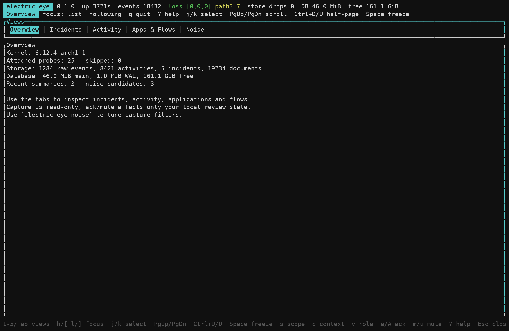
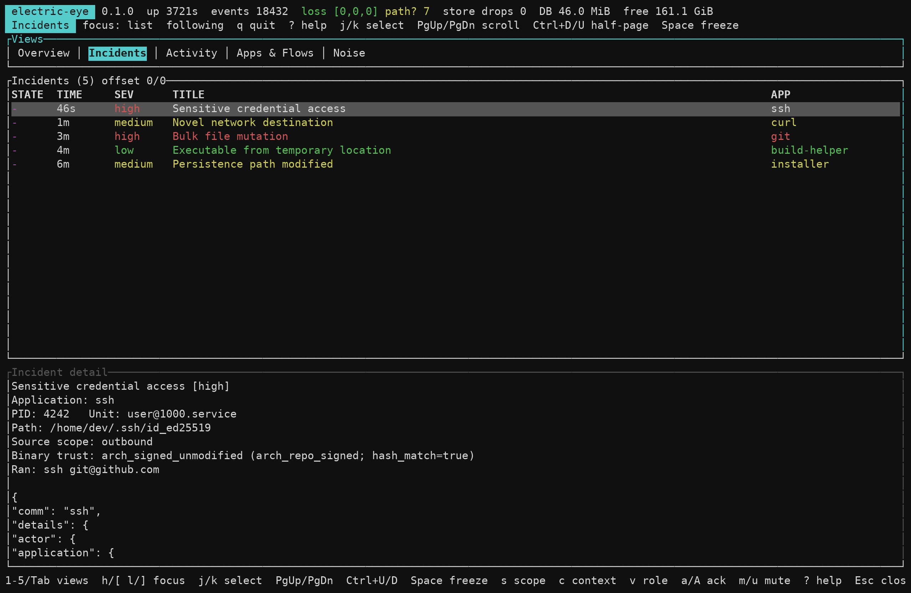
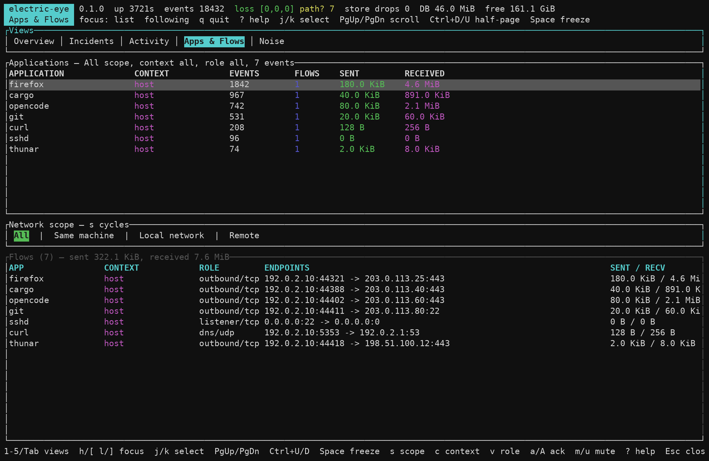

# electric-eye

[](https://github.com/jamesmcm/electric-eye/actions/workflows/ci.yml)

**Read-only Linux activity monitoring and evidence. Arch Linux is the primary
supported platform today.**

electric-eye explains what applications are doing: process lifecycles, file
activity, TCP/UDP flows, package trust and evidence-backed incidents. It is a
sensor and evidence server, not an enforcement tool or an agent runtime.

The daemon needs Linux 5.17+ with kernel BTF and tracefs. Packaging, package
provenance and the systemd service are Arch-specific; Nix/NixOS packaging is
not yet supported.



*Sanitized TUI example with fictional data.*

## What it gives you

- **Process, file and network evidence:** fork/exec/exit identity, ancestry,
  redacted arguments, writable opens, aggregated writes, truncation, unlink and
  rename outcomes, plus TCP/UDP flow lifecycles and byte totals.
- **Arch package trust:** read-only libalpm ownership, pacman validation status
  and package-mtree SHA-256 verification in incident evidence.
- **Applications and summaries:** application/task grouping across
  interpreters, desktop files, cgroups and ancestry; build, save, startup and
  download-like summaries retain their confidence and evidence.
- **Deterministic incidents:** sensitive paths, persistence, suspicious execs,
  credential sweeps and scope-aware bulk mutation. Local incoming traffic is
  not an incident by default; remote traffic keeps its higher severity.
- **TUI, CLI and MCP:** browse incidents, activity, applications and flows in a
  terminal UI; query with a readable CLI or JSON; connect your own agent over
  MCP with a compact default tool set.
- **Focused agent sessions:** configurable focus rules and automatic detection
  of Codex/OpenCode/Hermes/Omarchy/OMP-style logs. `investigate` returns a full
  evidence prompt for the caller's model.

## Install on Arch Linux

Use an AUR helper:

```bash
yay -S electric-eye       # builds from source
yay -S electric-eye-bin   # prebuilt x86_64 binaries
```

Or build the package from a checkout:

```bash
git clone https://github.com/jamesmcm/electric-eye.git
cd electric-eye/packaging/arch
makepkg -si
sudo systemctl enable --now electric-eye.service
electric-eye doctor
```

The service runs as its own unprivileged `electric-eye` system user with only
`CAP_BPF`, `CAP_PERFMON`, `CAP_DAC_READ_SEARCH` and `CAP_SYS_PTRACE`. Add
yourself to the `electric-eye` group for read-only CLI and MCP access:

```bash
sudo usermod -aG electric-eye "$USER"
# log out and back in, or use: newgrp electric-eye
```

See [Operations](docs/OPERATIONS.md) for build dependencies, daemon flags,
hardening scores and package details.

## Quick start

```bash
electric-eye status
electric-eye tui
electric-eye incidents --since 24h
electric-eye flows
electric-eye investigate <incident-id>
```

## TUI

| Incidents | Applications and flows |
| --- | --- |
|  |  |

The TUI has Overview, Incidents, Activity, Apps & Flows and Noise views. Use
`1`–`5`/Tab to switch, `j`/`k` to select, `h`/`l` to cycle focus, `s`/`c`/`v`
for network scope/context/role filters, `Space` to freeze, `?` for help and
`q` to quit. Acks and mutes update only your local review state. See
[Operations](docs/OPERATIONS.md#tui-and-operations) for the full key map.

*All screenshots in this README use fictional demo data, not a live system.*

## Agent integration

The daemon starts a read-only MCP server at `/run/electric-eye/mcp.sock`.
Connect your harness through the stdio bridge:

```json
{
  "mcp": {
    "servers": {
      "electric-eye": {
        "type": "local",
        "command": ["electric-eye", "mcp"]
      }
    }
  }
}
```

The default profile exposes only `status`, `activity`, `apps`, `flows`,
`incidents`, `focus` and `investigate` to keep agent context small. Enable the
full set with `mcp_tools = ["all"]` or `--mcp-tools all`. See
[MCP and agent integration](docs/MCP.md) for custom profiles, the installable
skill and investigation bundles.

## Read-only by design

electric-eye observes and reports. It does not block, quarantine, intercept
HTTPS, proxy traffic or enforce policy, and it does not bundle a model runtime.
The query API and MCP tools are read-only; acknowledgements and mutes are stored
locally by the CLI/TUI. See [Architecture](docs/ARCHITECTURE.md) for the capture
and evidence model.

## Documentation

| Document | Contents |
| --- | --- |
| [Architecture](docs/ARCHITECTURE.md) | capture model, provenance, grouping, retention |
| [Configuration](docs/CONFIGURATION.md) | full TOML reference, rules, focus, noise tuning |
| [Operations](docs/OPERATIONS.md) | install, daemon flags, TUI, doctor, ack/mute, testing |
| [MCP](docs/MCP.md) | tool profiles, bridge setup, investigation bundles |
| [Testing](docs/TESTING.md) | unit tests, LXC integration tests, load generator |
| [Limitations](docs/LIMITATIONS.md) | bounded metadata, uncertainty and deferred work |
| [Performance](docs/PERFORMANCE.md) | ring-buffer measurements and tuning |
| [Toolchain](docs/TOOLCHAIN.md) | pinned nightly, LLVM and `bpf-linker` notes |

## Build from source

```bash
nix develop
just release
```

Without Nix, install `rustup`, `clang`, `llvm`, `lld`, `bpf-linker`, `sqlite`,
`pacman` (libalpm) and `just`, then run `just release`. The recipe detects Arch
and uses the system Rust/pkg-config/sqlite toolchain so the binaries can load
Arch's `libalpm`. See [Toolchain](docs/TOOLCHAIN.md) and
[Operations](docs/OPERATIONS.md) for details.

## License

MIT.
